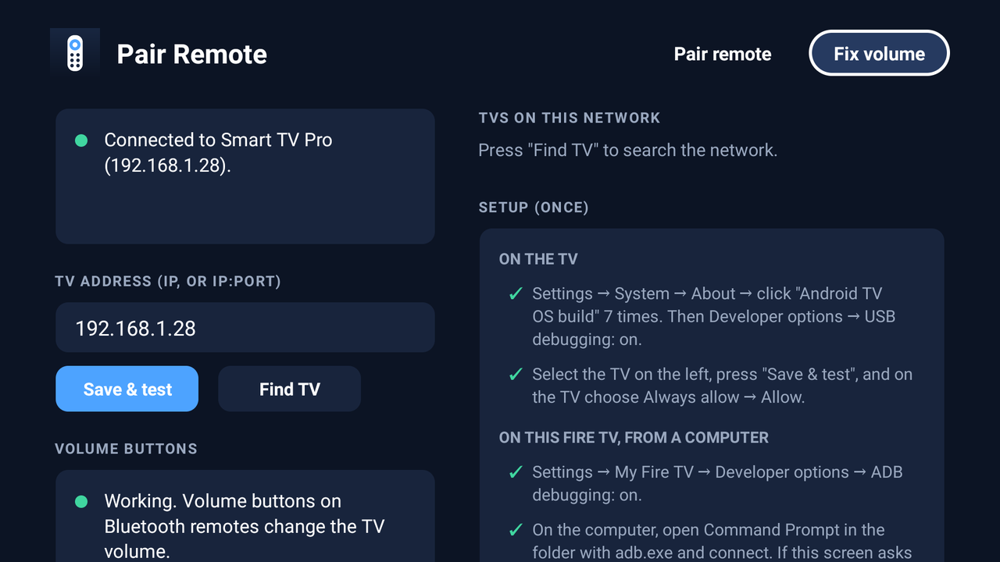

# Remote Pairing for Fire TV

Two small apps for Amazon Fire TV devices, built for a Fire TV Stick 4K Max (Fire OS 8) that
runs a custom launcher such as Projectivy:

- **Pair Remote:** pairs third-party Bluetooth remotes that the Fire OS pairing screen won't
  accept (SBB EON, MTS IRIS, …), and makes their **volume buttons control the TV**.
- **Fire TV Settings:** a launcher shortcut that opens the native Fire OS Settings screen.

Neither app needs root, changes the default launcher, or disables system packages.



## Download

Get the APKs from [Releases](https://github.com/djolemc/RemotePairing/releases):

| File | App | Package |
|---|---|---|
| `PairRemote-<version>.apk` | Pair Remote | `com.firetvsettings.pairremote` |
| `FireTVSettings-<version>.apk` | Fire TV Settings | `com.firetvsettings.shortcut` |

Install with [ADB](https://developer.android.com/tools/releases/platform-tools) from a computer
on the same network:

1. On the Fire TV: *Settings → My Fire TV → Developer options → ADB debugging: on*.
   (If Developer options is hidden: *Settings → My Fire TV → About*, click the device name 7 times.)
2. Find its IP address: *Settings → My Fire TV → About → Network*.
3. Run these commands. On the first connection, choose *Always allow → OK* on the TV.

```
adb connect <FIRE_TV_IP>:5555
adb install -r PairRemote-<version>.apk
adb install -r FireTVSettings-<version>.apk
```

You can also use a sideloading app such as Downloader instead.

> If a copy you built yourself is already installed, `adb install` fails with
> `INSTALL_FAILED_UPDATE_INCOMPATIBLE` (different signing key). Uninstall it first:
> `adb uninstall com.firetvsettings.pairremote`.

## Pair Remote

The app has two tabs and opens on the one you used last. It is controlled with the D-pad.

### Pair remote tab

Fire OS filters which Bluetooth remotes its own pairing screen will pair. This tab pairs them
directly through the Android Bluetooth API instead.

- It scans for 30 seconds, using classic discovery and BLE together. BLE remotes usually
  advertise their name, which classic discovery often misses.
- Remotes whose name contains `notus`, `eon`, `iris`, `mts` or `r11b` are paired automatically.
  Add others in `REMOTE_NAME_KEYWORDS` (`PairPage.kt`).
- Every nearby device is listed with its name, address, signal strength and type. Select one
  to pair a remote with an unusual name, or none. Hold the remote close to the Fire TV: the
  strongest signal (closest to 0 dBm) is usually the remote.
- Put the remote in pairing mode, and make sure it isn't connected to its original set-top box.
- **Location must be on** on Fire OS 8 (Android 11), or the scan returns nothing.
- Fire OS stores the pairing, not the app: uninstalling the app keeps the remote paired.

### Fix volume tab

Fire TV's HDMI output is fixed-volume. Fire OS receives the volume buttons of third-party remotes,
then drops them (`AmazonAudioService: ignore volume adjustment on fixed volume device`), and it
doesn't forward them over HDMI-CEC. This tab sends them to the TV over the local network instead.

**Requires** an Android TV or Google TV with network ADB, such as many TCL, Philips, Sony and
Xiaomi models. Tested with a TCL C635 (Google TV, Android 11).

**Setup (once).** The tab lists each step with the exact command for your device, and ticks it
off when it's done:

1. **TV:** *Settings → System → About →* click *Android TV OS build* 7 times. Then
   *Developer options → USB debugging: on*.
2. **App:** press *Find TV* and select the TV, or type its IP address. Press *Save & test*.
   On the TV, choose *Always allow → Allow*.
3. **Fire TV, from a computer:** turn on the app's background service. The value must list the
   services that are already on, or they will be switched off; the app shows the full command
   with them filled in:

   ```
   adb shell settings get secure enabled_accessibility_services
   adb shell settings put secure enabled_accessibility_services "<current value>:com.firetvsettings.pairremote/.VolumeKeyService"
   adb shell pm grant com.firetvsettings.pairremote android.permission.READ_LOGS
   ```

   After the last command, the app restarts once by itself.

**How it works**

```
Remote ──Bluetooth──► Fire TV ── Fire OS drops the key, but logs it:
                                 "Received Key name: VOLUME_UP, code: 24, action: 0"
                                          │
                       Pair Remote reads that one log tag
                                          │
                                          └──ADB over Wi-Fi──► TV:
                                             cmd media_session volume --adj raise
```

- Fire OS consumes volume keys before apps and accessibility services see them. It also drops ADB
  connections that an app opens to its own device. The only place the key presses stay visible
  is the line Amazon's device-control service writes to the system log. `KeyLogWatcher` runs
  `logcat` filtered to that single tag, which needs `READ_LOGS`.
- `TvLink` keeps one ADB connection to the TV open, using the
  [dadb](https://github.com/mobile-dev-inc/dadb) library and the app's own key. It runs
  `cmd media_session volume --show --stream 3 --adj raise|lower`, which takes about 0.1–0.2 s
  (`input keyevent` takes about 1.6 s). Holding a button repeats every 200 ms. Output devices
  such as soundbars on ARC follow the TV volume.
- `VolumeKeyService` is an accessibility service that only keeps the app running and starts it
  after a reboot. It doesn't filter keys or read screen content.
- *Find TV* checks the local /24 network for port 5555 and shows each device's Google Cast name.
  It never picks a device on its own.
- It works after TV standby and after a full TV restart.
- The Amazon remote changes the volume over infrared, so its presses aren't counted twice.
- Resource use on the Stick: 0 % CPU while idle and about 43 MB RAM.

**Limitations**

- This relies on an undocumented Amazon log line. A Fire OS update may change it, and volume
  forwarding would stop until the app is updated. Pairing is not affected.
- ADB debugging stays on, on both the TV and the Fire TV.
- If the TV gets a new IP address, press *Find TV* again. A DHCP reservation in the router avoids this.

**Undo:** uninstall the app, or set `enabled_accessibility_services` back to its previous value and
run `adb shell pm revoke com.firetvsettings.pairremote android.permission.READ_LOGS`.

**Logs:** `adb logcat -s RemotePairing VolumeBridge`

## Fire TV Settings

A tiny app that shows up in Projectivy (or any Android TV launcher). It opens Fire OS Settings
and closes itself; it has no UI of its own.

- It opens `com.amazon.tv.launcher/.ui.SettingsActivity` with an explicit intent. If that fails, it
  falls back to `android.settings.SETTINGS`, and if both fail it shows a short message.
- It uses the invisible `Theme.NoDisplay` and calls `finish()` in `onCreate()`. It starts Settings
  without `FLAG_ACTIVITY_NEW_TASK`, so *Back* returns to the launcher and nothing can loop.
- It has no permissions, services, network access or dependencies.

The Settings activity is **Amazon-specific and undocumented**, so a Fire OS update can rename or
remove it. If that happens, find the new one and update `FIRE_OS_SETTINGS` in
`LaunchSettingsActivity.kt`:

```
adb shell cmd package resolve-activity --brief -a android.settings.SETTINGS
```

Logs: `adb logcat -s FireTvSettings`

## Build

You need Android Studio, which bundles JDK 21, and Android SDK platform 36.1. The Gradle wrapper
(Gradle 9.5.0, AGP 9.3.3) handles the rest.

```powershell
$env:JAVA_HOME = "C:\Program Files\Android\Android Studio\jbr"
.\gradlew.bat assembleDebug      # app/… and pairremote/build/outputs/apk/debug/
.\gradlew.bat assembleRelease    # signed only if keystore.properties exists
```

Release signing reads `keystore.properties` from the project root. This file is not in git:

```properties
storeFile=C:/path/to/release.jks
storePassword=…
keyAlias=…
keyPassword=…
```

| Module | App | minSdk / targetSdk | Dependencies |
|---|---|---|---|
| `app` | Fire TV Settings | 26 / 36 | none |
| `pairremote` | Pair Remote | 26 / 36 | `androidx.activity`, `dadb` |

minSdk 26 covers Fire OS 7 (API 28) and Fire OS 8 (API 30). Both UIs are built in code, without
XML layouts. The icons and banners are PNGs generated with Pillow.

## Tested on

- Fire TV Stick 4K Max (2nd gen), Fire OS 8.1.8.5, with Projectivy Launcher
- SBB EON (NOTUS UC) and MTS IRIS (R11b) Bluetooth remotes
- TCL C635 Google TV (Android 11), with a soundbar on HDMI ARC
